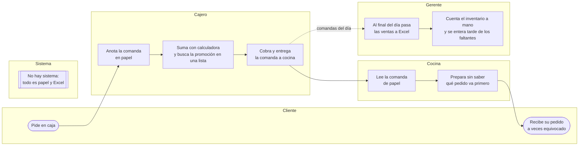
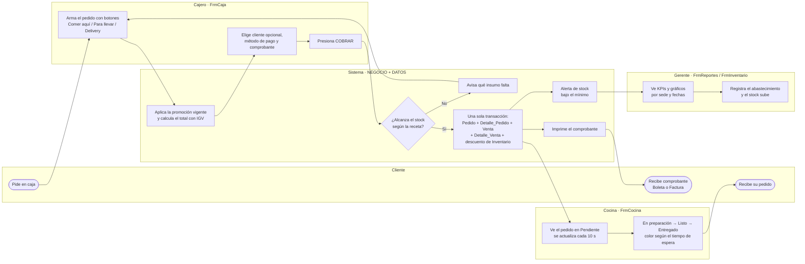

# Diagrama del proceso: Venta en caja y preparación de pedidos

**SPYC:I**, cadena de comida rápida con 5 sedes.
Carriles: **Cliente / Cajero / Sistema / Cocina / Gerente**.
La versión editable (draw.io, 2 páginas: ANTES y DESPUÉS) está en [`diagrama_proceso.drawio`](diagrama_proceso.drawio).
Se abre en <https://app.diagrams.net> o con la extensión *Draw.io Integration* de VS Code.

---

## ANTES (proceso manual)

**Problemas:** errores de cálculo y de promociones, comandas ilegibles o perdidas, sin control de tiempos en cocina, inventario desactualizado (se descubre que falta un insumo cuando el cliente ya pagó) y reportes que llegan un día después.

---

## DESPUÉS (con la aplicación SPYC:I)

**Mejoras:**
- **Precio correcto siempre:** el sistema aplica la promoción vigente y calcula el IGV.
- **Cobro en un solo paso:** la venta se registra completa o no se registra.
- **Inventario siempre actualizado:** los insumos se descuentan solos según la receta (`Plato_Insumo`).
- **Cocina ordenada:** los pedidos se muestran por estado y con su tiempo de espera.
- **Gerente informado al momento:** reportes del día y alertas de stock.

## Pantallas por paso

| Paso | Pantalla | Tablas / objetos de BD |
|------|----------|------------------------|
| Login y menú por perfil | `FrmLogin`, `FrmPrincipal` | `Usuario`, `sp_Buscar_Usuario` |
| Clientes | `Cliente` | `Cliente` |
| Venta en caja | `FrmCaja` | `Plato`, `Promocion`, `Pedido`, `Detalle_Pedido`, `Venta`, `Detalle_Venta`, `Inventario`, `Metodo_Pago` |
| Preparación | `FrmCocina` | `Pedido`, `sp_Pedidos_Cocina`, `sp_Cambiar_Estado_Pedido` |
| Inventario | `FrmInventario` | `Inventario`, `Insumo`, `Unidad_Medida`, `Abastecimiento`, `Detalle_Abastecimiento`, `Proveedor`, `Plato_Insumo` |
| Reportes | `FrmReportes` | SPs basados en `ventas_por_sede`, `platos_mas_pedidos`, `Vista_Mapa_Calor_Horas_Pico`, `Vista_Top_Clientes_VIP`, `Vista_Efectividad_Promociones` |
